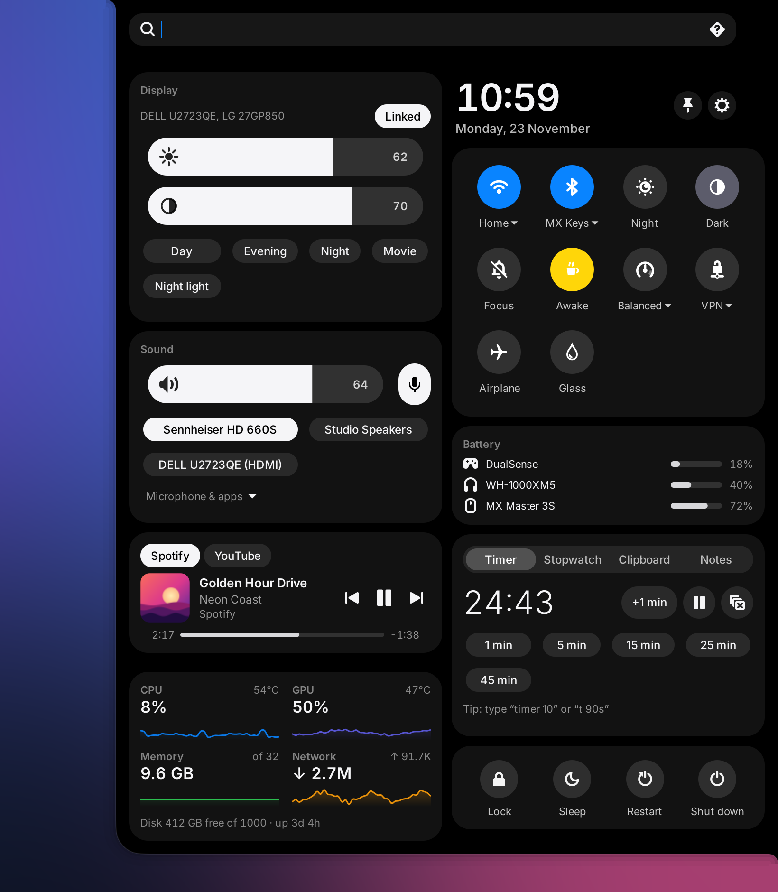
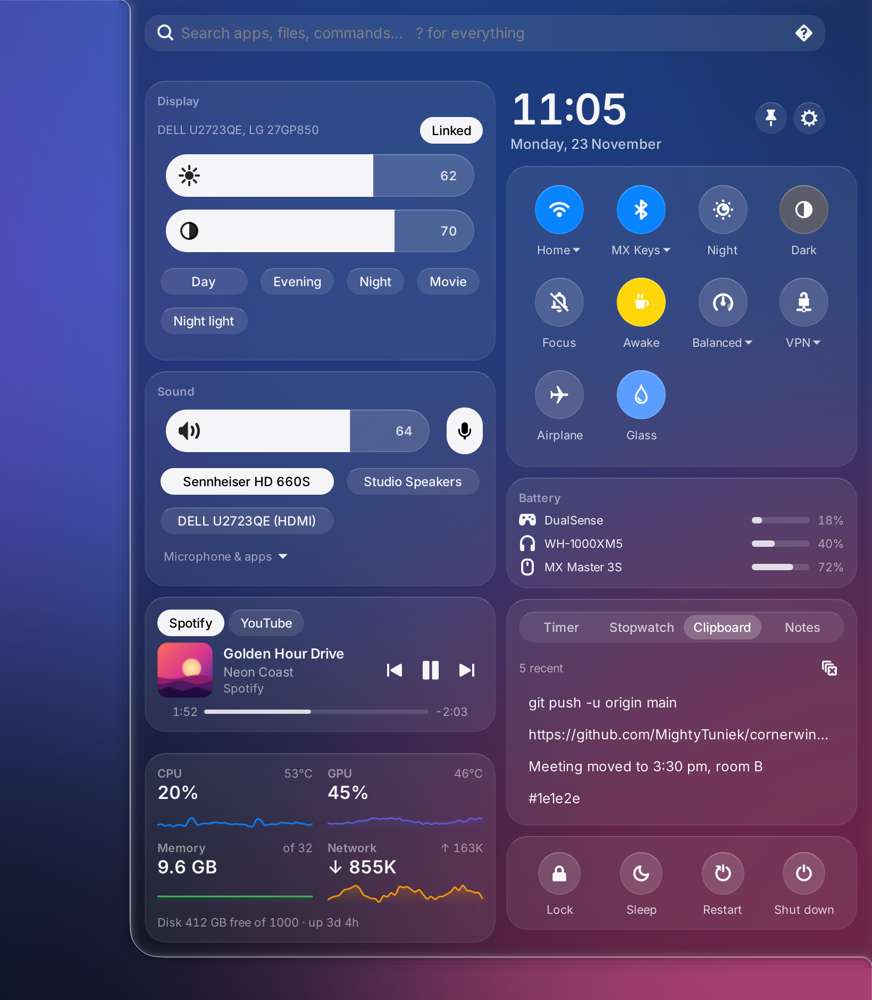
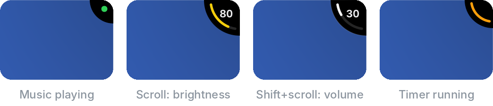
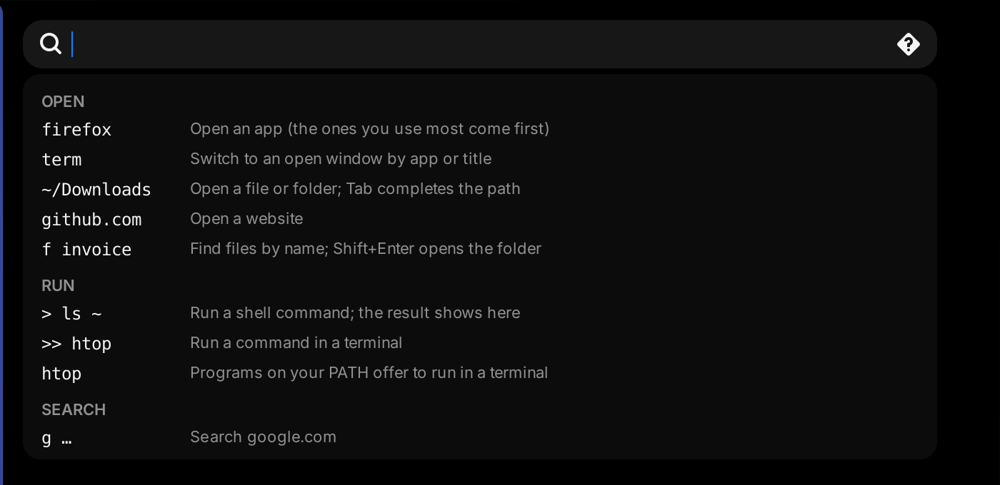
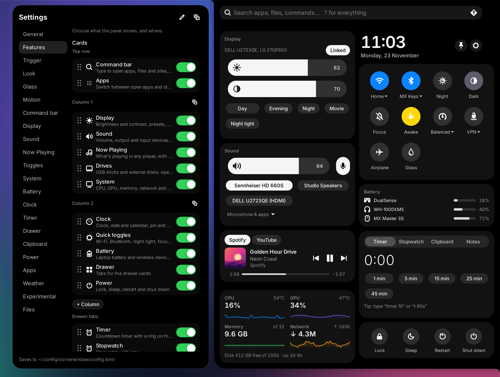

# CornerWindow

A hidden corner island for Linux: a quick panel that springs out of your screen corner.

<p align="center">
  
  
</p>

A tiny black quarter-circle, the **trigger**, sits in a corner of your screen. Click it and it springs open into the **panel**, with cards pouring out of the corner one after another. Click outside, press <kbd>Esc</kbd> or click the trigger again and it folds back up.

It runs on GNOME, KDE, Hyprland, Sway and more, on X11 or Wayland. Each feature checks whether it works on your machine and hides itself if it doesn't. Requires Python 3.11 or newer, plus PyGObject and pycairo from your distro; `./install.sh` handles them.

## Features

### Collapsed

The trigger stays almost invisible.

<p align="center">
  
</p>

| Input | Effect |
|---|---|
| Hover | The trigger grows a little and shows a faint rim of light |
| Scroll | Change monitor brightness without opening the panel |
| <kbd>Shift</kbd>+scroll | Change volume |
| Middle-click | Mute output |
| Right-click | Play or pause media |

**Live activities.** The trigger grows to show an arc and a value when brightness or volume changes. It also shows a ring while a timer runs, a red dot while your mic is muted or your laptop battery is low, a yellow dot while Awake is on, a green dot while music plays or the stopwatch runs, and an orange dot when a window asks for attention while the taskbar is hidden.

**Fullscreen.** The trigger hides while a fullscreen game or video has focus.

### Open

| Card | Contents |
|---|---|
| Display | Brightness and contrast over DDC/CI, presets, night light; one slider per monitor if you unlink them |
| Sound | Volume, output and input devices, mic level, and a slider for each app playing sound |
| Now playing | Artwork, title, source, seekable progress, shuffle and repeat; chips switch between players |
| Drives | USB sticks, SD cards and phones: open and eject (only while one is plugged in) |
| Toggles | Wi-Fi and Bluetooth (with network and device pickers), night light, dark mode, focus, awake, power mode, VPN, airplane mode |
| Battery | Laptop battery and wireless devices: mouse, keyboard, headset, controller (only when there is one) |
| System | CPU, GPU, memory and network sparklines, disk space, uptime |
| Clock | Time and date; click the date for a month calendar |
| Drawer | Timer, stopwatch with laps, clipboard history, self-saving scratchpad |
| Power | Lock, sleep, restart, shut down, each with press-and-hold to confirm |
| Weather | Now, the next hours and days (off by default) |
| Command bar | Type to open apps, switch to open windows, run commands, calculate and convert units |
| Apps | Your favourite and running apps, a taskbar inside the panel (shown while the taskbar is hidden, see below) |

Choose which cards you see, and where, under **Settings → Features**: every card has a switch, and you drag it between the top row, the columns and the drawer. Quick toggles and power buttons are switched and reordered the same way on their own pages.

- Display changes real monitor settings over DDC/CI, not a dimming filter. Click a preset (Day, Evening, Night, Movie) to apply it, or hold one to save your current values into it.
- Now playing works with every player that speaks MPRIS: Spotify, VLC, mpv, Rhythmbox, Strawberry, Cider (Apple Music), KDE Connect (your phone), and browser tabs on YouTube, YouTube Music, SoundCloud, Apple Music, Spotify web, Deezer, Tidal, Twitch and more, labelled by site ("YouTube · Firefox"). MPD works directly too, without mpDris2. It appears only while something is loaded.
- Click the label under the Wi-Fi or Bluetooth toggle (or right-click the toggle) to pick a network or connect a paired device.

#### Without a taskbar (experimental)

CornerWindow can hide the desktop's taskbar while it runs: switch on **Settings → Experimental → Hide the taskbar** (`[experimental] hide_taskbar = true`). It works with Zorin Taskbar and Dash to Panel (their auto-hide is set so the panel never comes back on its own, and maximised windows get its space) and with Dash to Dock and Ubuntu Dock (the extension is switched off).

You switch apps from the panel instead:

| Where | How |
|---|---|
| Apps card (top row) | Click an app to switch to it; click the app you're in to minimise it. An app with several windows opens a list to pick one or close it. Middle-click opens a new window, right-click shows the windows. Favourites from the desktop's dash or taskbar stay there for one-click launching. |
| Command bar | Type part of an app's name or a window's title and press <kbd>Enter</kbd> to switch to it. `desktop` shows the desktop. |
| Trigger | Bind `windows.cycle` to a gesture (Settings → Trigger) to scroll through windows without opening the panel. |
| Keyboard | <kbd>Alt</kbd>+<kbd>Tab</kbd> and <kbd>Super</kbd> keep working. |

The taskbar comes back when you switch the setting off and when CornerWindow quits (logging out included), and is hidden again on the next start. If CornerWindow ever crashes with the taskbar hidden, run `cornerwindow taskbar show`. The taskbar's tray icons and clock are hidden with it; the Activities overview and Zorin Taskbar's <kbd>Super</kbd>+<kbd>I</kbd> still show it. X11 only for now: on Wayland the Apps card can't see other apps' windows.

#### Command bar

Start typing anywhere in the open panel, or click the bar. The **?** button at its right end (or typing `?`) opens a scrollable list of everything below; click an example to put it in the bar.

<p align="center">
  
</p>

| Input | Effect |
|---|---|
| `firefox` | Switch to Firefox if it's open, or open it (any installed app; the ones you open most come first) |
| `~/Downloads` | Open a file or folder; <kbd>Tab</kbd> completes the path |
| `github.com` | Open a website |
| `f invoice` | Find files by name (uses `plocate` if installed); <kbd>Shift</kbd>+<kbd>Enter</kbd> opens the folder |
| `> ls ~` | Run a shell command; its last line of output shows in the bar |
| `>> htop` | Run a command in a terminal (`htop` alone offers this for any program on your PATH) |
| `yt lofi` | Search shortcuts: `g`, `yt`, `w` (Wikipedia), `gh`, `maps`, or your own in Settings → Command bar |
| `b 40` | Set brightness to 40 (`b 40 2` sets only the second monitor) |
| `night` | Apply the Night preset |
| `timer 10` | Start a 10-minute timer (`t 90s`, `timer 1h30m`, `timer stop`) |
| `alarm 7:30` | Ring at a time of day (`alarm 7pm`) |
| `sw` | Start or pause the stopwatch |
| `seek +30` | Skip ahead in what's playing (`seek 1:20`, `shuffle`, `repeat`, `player spotify`) |
| `bt headphones` | Connect a paired Bluetooth device |
| `cb pass` | Search the clipboard history; <kbd>Enter</kbd> copies |
| `note buy milk` | Add a line to Notes (`note milk` also finds lines) |
| `restart` | `lock`, `sleep`, `logout`, `restart`, `shutdown`; the last three need <kbd>Enter</kbd> twice |
| `2*(3+4)` | Calculate; <kbd>Enter</kbd> copies the answer. Also `15% of 80`, `80 + 15%`, `0xff to bin`, `1<<4` |
| `5 km to mi` | Convert units: length, weight, volume, area, speed, temperature, data, time |
| `100 usd to eur` | Convert currencies (ECB daily rates from frankfurter.dev, fetched only when you ask) |
| `time in tokyo` | Times and dates: `3pm london to tokyo`, `now + 90m`, `days until dec 25`, `today`, `week`, `@1700000000` |
| `:heart` | Emoji and symbols (`:arrow`, `:degree`); <kbd>Enter</kbd> copies |
| anything else | Search the web (DuckDuckGo by default, set in Settings → Command bar) |

<kbd>↑</kbd> in an empty bar brings back what you ran before (`forget` clears it). `c`, `v`, `mute`, `eject`, `battery`, `weather`, `settings` and more are in the command bar too.

## Install

```bash
./install.sh
```

The script:

- Installs any missing distro packages (apt, dnf, pacman or zypper).
- Asks for sudo once to add a udev rule, so you can control your monitor over I²C without root. For external monitors, turn on DDC/CI in the monitor's own on-screen menu (most ship with it on). If `doctor` says the monitor doesn't answer, that setting is the usual cause.
- Builds the Liquid Glass pixel kernel if a C compiler is present.
- Puts `cornerwindow` in `~/.local/bin`.
- Starts CornerWindow with your session.
- On GNOME, binds <kbd>Super</kbd>+<kbd>\\</kbd> to open and close it.
- Runs `cornerwindow doctor` at the end.

Flags: `--no-sudo`, `--no-hotkey`.

To update, pull the repo and run `./install.sh` again. To remove CornerWindow, run `./uninstall.sh`. It stops the app and removes the launcher, autostart entry, hotkey, udev rule and build cache, and keeps your settings. Add `--purge` to delete those too.

## Command line

```bash
cornerwindow doctor                        # what works, and how to fix what doesn't
cornerwindow toggle                        # also: open, close
cornerwindow set brightness 40             # absolute
cornerwindow set brightness +10            # relative; also contrast, volume
cornerwindow get contrast
cornerwindow actions                       # list bindable actions
cornerwindow action display.preset.night
cornerwindow settings display              # open the settings window, optionally on a page
cornerwindow taskbar show                  # bring the taskbar back (also when CornerWindow isn't running)
```

For the fastest possible hotkey, bind the D-Bus call directly. This is what `./install.sh` does:

```bash
gdbus call --session --dest io.github.cornerwindow --object-path /io/github/cornerwindow --method org.gtk.Actions.Activate toggle [] {}
```

## Configuration

### Configuration files

Configuration is built from three layers. Later layers win; tables merge and lists replace.

1. [`config/default.toml`](config/default.toml): every option, with comments
2. [`config/machines/*.toml`](config/machines): per-PC tuning, picked by a `[match]` table on hostname or monitor model
3. `~/.config/cornerwindow/config.toml`: your own overrides, which the settings window writes

For example, `~/.config/cornerwindow/config.toml`:

```toml
[general]
corner = "top-left"

[trigger]
radius = 16
scroll = "audio.volume.step"   # scroll changes volume instead of brightness

[modules]
columns = [["header", "display", "audio"], ["toggles", "drawer", "power"]]
```

### Settings window

Click the gear button in the panel, or run `cornerwindow settings`. Options are grouped into pages such as General, Trigger, Look and Motion, plus one for each card. A Files page shows each config file and has a raw editor for yours.

<p align="center">
  
</p>

- **Live changes.** The panel rebuilds in place and springs to its new size. A running timer, your clipboard history and the settings window itself carry over.
- **Minimal writes.** Only values that differ from the defaults and machine file go into your file. Comments and formatting survive; the file is edited in place.
- **Live reload.** Edits to any config file show up in the window right away, including the defaults and machine file, in any editor.
- **Value origins.** A "this PC" badge means the value comes from your machine file. A "changed" badge means your own file, and those rows get a reset (↺) button to go back to the default.
- **Unknown options.** New keys and sections from your own modules still appear, with an editor picked from the value's type.

### Theming

The island is solid black by default. Switch on **Liquid Glass** with the *Glass* quick toggle, in Settings → Look, or with `cornerwindow set panel.glass true`. The switch applies instantly, without rebuilding the panel.

Liquid Glass is not a blur with a white wash. The panel is a lens over whatever is behind it:

- **Lensing.** Near the rim the backdrop bends inward like a thick convex edge, with a slight colour fringe where it bends most. The middle stays undistorted.
- **Frost and tint.** These range from clear glass to frosted, and from see-through to legible: `glass.frost` and `glass.tint`.
- **Specular rim.** A thin white edge plus a soft inner glow, lit from `glass.light_angle`, with a weaker highlight on the far side.
- **Light and dark.** The appearance follows your desktop's light/dark setting by default (`glass.appearance = "system"`). It can also be forced `light` or `dark`, or set to `adaptive`, which picks by how bright the content behind is. Text, icons and controls switch with it.
- **The whole surface.** It reaches from the droplet-shaped trigger to the open panel and the Settings window, and a press lights the glass up from the touch point.

The backdrop is live on X11: windows behind the panel are composited with XComposite and XDamage, so a video or a window you drag shows through as it moves. When nothing behind changes, nothing is redrawn. GNOME Shell's own UI is drawn by the compositor and can't be read, so the top bar, the taskbar and notifications show the wallpaper instead. On Wayland the backdrop is the wallpaper only.

The per-pixel work is a small C file compiled on first use (`install.sh` builds it too), so Liquid Glass needs a C compiler (gcc or clang) once. Without one, the toggle hides itself and `cornerwindow doctor` says why.

The panel's corners at the screen edges are set with `panel.ears`: positive values flare outward, negative values round into the panel, and 0 makes them square.

To restyle anything, put CSS in `~/.config/cornerwindow/style.css`. Glass styles are scoped under the `.cw-glass` and `.cw-light` classes.

## Animation

- Every movement uses spring physics (SwiftUI-style `response`/`damping`), driven by the frame clock at your monitor's refresh rate.
- Springs keep their velocity, so clicking again mid-animation reverses it smoothly instead of snapping.
- The window is never resized or moved while animating. It is sized once, everything outside the outline is transparent and click-through, and only the outline is redrawn.
- During the morph, each card is drawn once into an offscreen image and then just blended in. Nothing is laid out again mid-animation.
- Sliders follow the pointer exactly and stretch with a rubber-band effect at the ends. Hardware catches up in the background through a writer that only sends the latest value, so dragging never lags.
- Nothing ticks while the panel is collapsed, so idle CPU use is 0%.

Set `CORNERWINDOW_FPS=1` to print frame statistics for each animation.

## Development

Writing your own modules, the layout of the code and running the tests are covered in [`docs/DEVELOPING.md`](docs/DEVELOPING.md).

## License

GPL-3.0-or-later. See [`LICENSE`](LICENSE).
